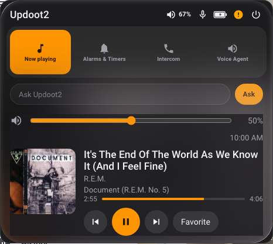
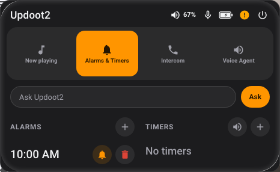
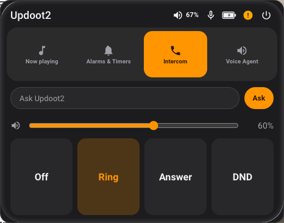
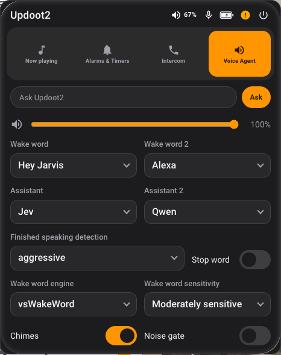
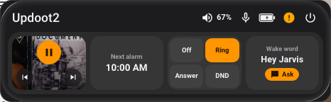

# Helpmeet: Kiosk Satellite Card

[](https://github.com/Helpmeeters/kiosk-satellite-card)
[](https://github.com/Helpmeeters/kiosk-satellite-card/releases)
[](LICENSE)

A [HACS](https://hacs.xyz/) Lovelace card for managing an audio-only **Kiosk Satellite** in Home Assistant — bringing together media playback, alarms and timers, intercom, and voice assistant controls in one compact, tabbed interface.

<p align="center">
  
</p>

## Features

- **Now Playing** — Album art, track info, live progress bar, media volume slider, playback controls, and favorite button.
- **Alarms & Timers** — Side-by-side alarms and timers with inline creation, snooze, stop, and timer mute.
- **Intercom** — Dedicated intercom volume and one-tap mode switching (**Off**, **Ring**, **Answer**, **DND**).
- **Voice Agent** — Configure wake words, assistants, sensitivity, finished-speaking detection, chimes, and noise gate.
- **Compact Mode** — Click the active tab to collapse the card into four interactive mini tiles for glanceable control.
- **Inline Ask** — Send text queries directly to your satellite's configured voice assistant from the dashboard.
- **Header Quick Controls** — Master volume popup, mic mute toggle, battery status, firmware update indicator with diagnostics, and device power/admin menu.

## Screenshots

<table>
  <tr>
    <td align="center" width="50%">
      <br />
      <sub><strong>Alarms &amp; Timers</strong></sub>
    </td>
    <td align="center" width="50%">
      <br />
      <sub><strong>Intercom</strong></sub>
    </td>
  </tr>
  <tr>
    <td align="center" width="50%">
      <br />
      <sub><strong>Voice Agent</strong></sub>
    </td>
    <td align="center" width="50%">
      <br />
      <sub><strong>Compact Mode</strong></sub>
    </td>
  </tr>
</table>

## Installation

### HACS (Recommended)

[](https://my.home-assistant.io/redirect/hacs_repository/?owner=Helpmeeters&repository=kiosk-satellite-card&category=plugin)

Or add it manually in HACS:

1. Open **HACS** in Home Assistant.
2. Click the three-dot menu in the top right and select **Custom repositories**.
3. Enter `https://github.com/Helpmeeters/kiosk-satellite-card` and select **Dashboard** (or **Lovelace**) as the category.
4. Click **Add**, then search for **Helpmeet: Kiosk Satellite Card** and click **Download**.
5. Refresh your browser when prompted.

### Manual Installation

1. Download `kiosk-satellite-card.js` from the [latest release](https://github.com/Helpmeeters/kiosk-satellite-card/releases/latest).
2. Copy it to `/config/www/kiosk-satellite-card.js`.
3. In Home Assistant, go to **Settings → Dashboards → Resources**, click **Add Resource**, and enter:
   - **URL**: `/local/kiosk-satellite-card.js`
   - **Resource type**: `JavaScript Module`

## Configuration

### Visual Editor

Add **Kiosk Satellite Card** from the Home Assistant dashboard card picker and select your device in the **Kiosk satellite** dropdown.

### YAML

```yaml
type: custom:kiosk-satellite-card
device: a78b06196d065fff7a9bf5c7331e0e5e
```

| Option | Type | Required | Description |
| --- | --- | --- | --- |
| `type` | `string` | **Yes** | `custom:kiosk-satellite-card` (legacy `custom:kiosk-redisplay` is also supported). |
| `device` | `string` | **Yes** | Device ID of an audio-only Kiosk Satellite (`kiosk_satellite` manufacturer with an `assist_satellite` entity). |

## Requirements

- A Kiosk Satellite device integrated into Home Assistant (ESPHome audio satellite).
- To **create alarms** from the card, `script.kiosk_satellite_alarms` must be configured and the kiosk's Home Assistant token must have administrator permissions. (Viewing, snoozing, and stopping alarms work directly from device entities.)

## Technical Reference

For entity pairing rules, service calls, and fallback behavior, see the [Technical Reference](docs/technical-reference.md).

## Contributing

Bug reports and pull requests are welcome. See [CONTRIBUTING.md](CONTRIBUTING.md) for the development setup and [SECURITY.md](SECURITY.md) for reporting vulnerabilities privately.

## Written with AI assistance

Much of this card's code, tests, and documentation was written with the help of AI coding assistants, then reviewed, tested, and directed by a human maintainer. If something looks wrong, please [open an issue](https://github.com/Helpmeeters/kiosk-satellite-card/issues).

## License

[MIT](LICENSE). Kiosk Satellite Card is part of Helpmeet, a family of Home Assistant integrations.
